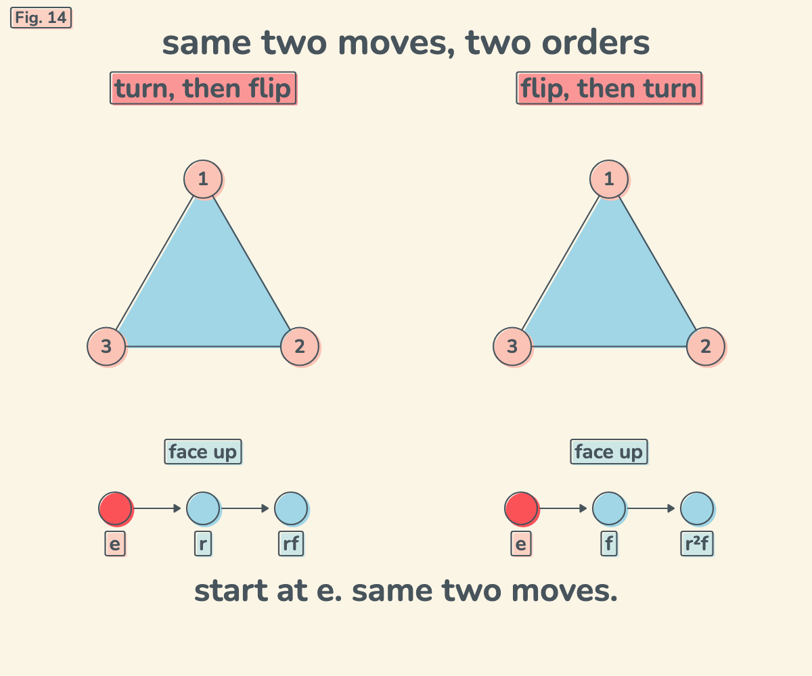

# The Dihedral Group

Fig. 14 in my "math facts that live in my head" series. The dihedral group D3: the six ways a triangle can sit. It has two moves, turn (r) and flip (f).

Three turns bring you home, and two flips bring you home. But turn then flip lands somewhere different from flip then turn (r · f is not f · r). It is the smallest group where order matters. The video runs both orders side by side, then undoes them.

Open it: https://ibeez.github.io/dihedral-triangle/



[Watch one loop (MP4)](exports/dihedral-triangle-loop.mp4): 11 seconds with sound, H.264 + AAC, 1200 x 1000 at 30 fps.

## Run It Locally

```bash
cd ~/Documents/Notes/03-Math-Facts+Games && python3 -m http.server 8792 --bind 127.0.0.1
```

Then open http://127.0.0.1:8792/dihedral-triangle/.

`video.html` is the build source for the video (it needs the vault's `design/` tools, so it only runs inside the vault).
